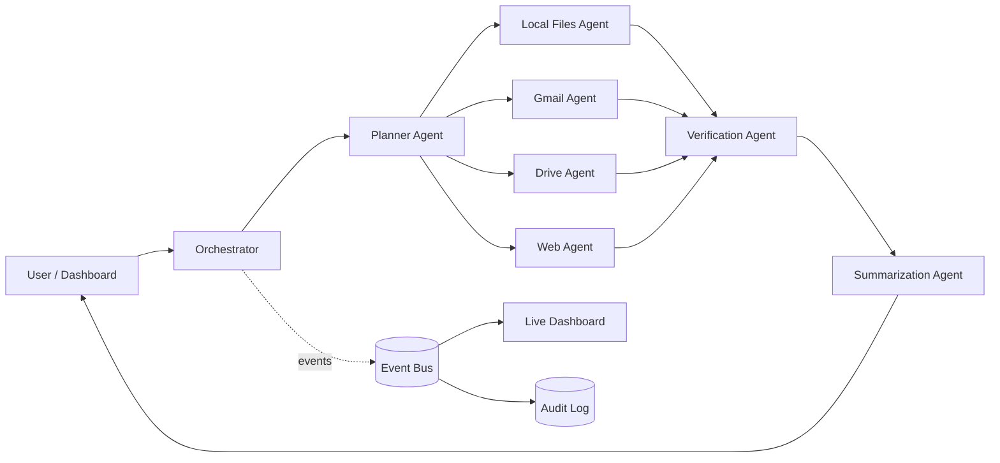

# LocalAgent AI
A privacy-preserving multi-agent assistant that searches local files, Gmail, Google Drive
and the web from one question, using a **local LLM (Ollama)**. Nothing is sent to a
cloud LLM.

## Architecture

## Privacy design
- Local LLM via Ollama on localhost; dashboard bound to 127.0.0.1
- Deny-by-default `permissions.json` (allowed sources and folders) plus per-query checkboxes
- Google access is read-only (`gmail.readonly`, `drive.readonly`); token stays on disk locally
- Web agent redacts emails and long numbers before searching
- Audit log records agent actions, never message or file contents

## Setup
1. Install Ollama, then `ollama pull llama3.2`
2. `pip install -r requirements.txt`
3. Google Cloud: enable Gmail and Drive APIs, create a Desktop OAuth client, save it as `credentials.json`
4. Edit `permissions.json` (`allowed_sources`, `allowed_dirs`)
5. `python server.py`, then open http://127.0.0.1:8000

## Tests
`python -m pytest -q`

## Limitations and future work
Keyword (BM25) local search; small local models can be slow on CPU; possible extensions
are embeddings-based retrieval, calendar and notes agents, and encrypted audit logs.